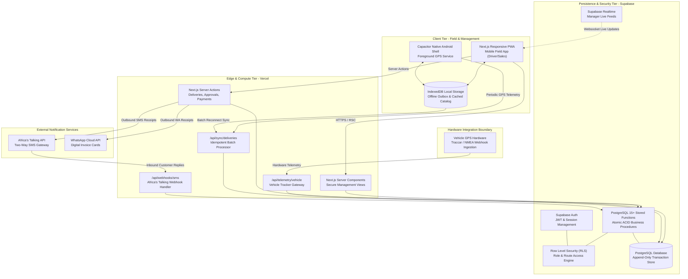

# GDMS — System Architecture Proposal (Corrected & Aligned)

## 1. Architectural Philosophy: The Modular Monolith

GDMS is architected as a **Modular Monolith** built on Next.js 15+ (App Router) and Supabase (PostgreSQL 15+).

### Operational Rationale for Modular Monolith over Microservices
1. **ACID Transaction Guarantees**: In glass distribution, creating a delivery, deducting truck inventory, updating customer credit balances, and declaring payment breakdowns must execute within single, atomic database transactions. Distributed transactions across microservices introduce split-brain risks, partial failures, and data discrepancies—the exact failure modes this system exists to eliminate.
2. **Operational Simplicity**: A commercial glass distribution enterprise requires high reliability with minimal operational overhead. A modular monolith avoids Kubernetes cluster complexity, service-to-service authentication overhead, and distributed tracing costs.
3. **Domain Cohesion with Next.js**: Next.js App Router isolates domain modules (`/modules/deliveries`, `/modules/inventory`, `/modules/payments`, `/modules/fleet`) while sharing strict TypeScript types and atomic database functions.

---

## 2. High-Level Architecture Diagram

---

## 3. Layer Breakdown & Implementation Strategy

### A. Presentation & Application Layer (Next.js App Router)
- **Server Components (`RSC`)**: Used for all management, owner, and accountant views. Renders financial data securely on the server without leaking sensitive business logic or master price calculation algorithms to the browser.
- **Client Components (`"use client"`)**: Used for the field delivery workflow, interactive glass dimension calculators, and local offline forms.
- **Server Actions & Route Handlers**: Sensitive business logic (price approvals, delivery submissions, payment declarations, debt collections) executes exclusively on the server with Zod schema validation and session-based authorization checks.

### B. Mobile Runtime & GPS Execution Strategy
- **Tier 1 (Universal PWA Mode)**: Standard web application accessible via mobile Chrome/Safari with service worker caching for offline assets. Captures high-accuracy point-in-time GPS fixes at delivery submission.
- **Tier 2 (Capacitor Android Native Shell)**: For active shift tracking, the PWA is hosted inside an Android APK wrapper with a persistent foreground service (`FOREGROUND_SERVICE_LOCATION`), displaying a non-dismissible notification to sample breadcrumbs reliably every 3–5 minutes.
- **Tier 3 (Vehicle Tracker Boundary)**: Dedicated hardware GPS units wired to truck batteries ingest data via `/api/telemetry/vehicle` directly into `location_samples` (`source = 'vehicle_tracker'`).

### C. Data Persistence & Security (Supabase PostgreSQL 15+)
- **Row-Level Security (RLS)**: Enforces access control at the database kernel level. Unauthorized queries across routes or roles are rejected by the database engine.
- **Atomic Stored Procedures (`SECURITY DEFINER`)**: Critical multi-table operations (e.g. deducting truck inventory + generating delivery record + creating payment declarations + scheduling SMS) execute inside single atomic PL/pgSQL procedures with explicit schema search paths (`SET search_path = public, pg_temp;`).
- **Append-Only Immutability**: PostgreSQL `BEFORE DELETE` triggers prevent deletion of submitted deliveries, items, payments, collections, and audit logs.

### D. External Telephony Gateway (Africa's Talking)
- **Primary Two-Way SMS Engine**: Sends automated delivery receipts with reference codes (e.g. `GD-00125`) and captures inbound customer replies (`1` for YES, `2` for NO, `1-5` for disputes).
- **Persistent Inbound Event Model**: Inbound SMS webhooks write raw payloads to `inbound_sms_messages` with `provider_message_id` deduplication before processing business logic.
