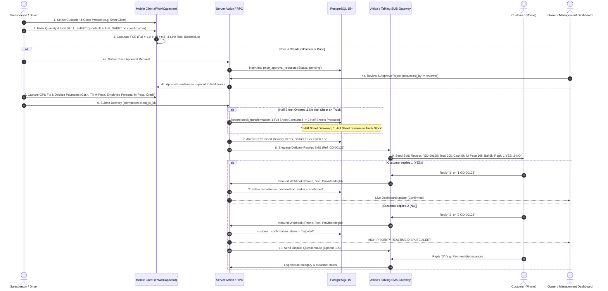

# TOKA GDMS — Core Business Workflows & State Transitions (Confirmed Rules)

## 1. Full-Sheet & Half-Sheet Delivery Workflow



---

## 2. Half-Sheet Preparation & Stock Transformation Flow

```
[ Customer Orders 1 Half Sheet ]
               │
               ▼
   [ Check Truck Physical Stock ]
               │
       ┌───────┴───────┐
       ▼               ▼
[ Half Sheet Exists ]  [ Only Full Sheets Available ]
       │               │
       │               ▼
       │      [ Execute Transformation Procedure ]
       │      1. Deduct 1 Full Sheet from Truck
       │      2. Add 2 Half Sheets to Truck
       │      3. Log stock_transformation record
       │               │
       └───────┬───────┘
               ▼
[ Deliver 1 Half Sheet to Customer ]
               │
               ▼
[ 1 Half Sheet REMAINS in Truck Physical Stock ]
(Never discarded, never marked scrap; available for future orders)
```

---

## 3. Financial Declarations, Turnover & Unallocated Collections

### A. Field Delivery Payment Declaration
1. During delivery creation, employee declares payments across 4 channels:
   - Physical Cash ($C_{\text{cash}}$)
   - Company Paybill/Till M-Pesa ($C_{\text{mpesa\_co}}$)
   - Employee Personal Phone M-Pesa ($C_{\text{mpesa\_emp}}$)
   - Authorized Credit Balance ($Cr_{\text{auth}}$)
2. Total Declared Paid: $P_{\text{del}} = C_{\text{cash}} + C_{\text{mpesa\_co}} + C_{\text{mpesa\_emp}}$.
3. Unpaid Balance: $B_{\text{inv}} = \text{Total Invoice Amount} - P_{\text{del}}$.
4. If $B_{\text{inv}} > 0$:
   - System verifies customer has `is_credit_eligible = true` and $(B_{\text{cust}} + B_{\text{inv}}) \le \text{Credit Limit}$.
   - Delivery `payment_status` is set to `partially_paid` (or `credit` if $P_{\text{del}} = 0$).

### B. Daily Shift Turnover (Employee Liability Settlement)
1. At the conclusion of a shift, driver/salesperson visits company cashier.
2. Total Employee Liability:
   $$L_{\text{emp}} = \sum_{\text{shift}} C_{\text{cash}} + \sum_{\text{shift}} C_{\text{mpesa\_emp}}$$
3. The employee physically remits the cash and either forwards personal M-Pesa to company till or withdraws cash.
4. Cashier counts funds, verifies M-Pesa transactions, and executes `settle_employee_turnover` RPC in GDMS.
5. If physical remittance matches declared liability, `variance = 0.00`; if funds are missing, an immediate debt discrepancy is logged against the employee profile.

### C. Unallocated Collections & Explicit Allocations
> [!IMPORTANT]
> **Strict Anti-Fraud Rule**: An unallocated collection remains visible as unapplied customer money. The system must **never** arbitrarily apply it to an invoice or reduce an invoice's outstanding balance without an explicit allocation record (`payment_allocations`).

1. When a Cash Collector receives payment without specifying an invoice, it is recorded in `collections` with `unallocated_amount = total_amount` and `is_fully_allocated = false`.
2. The customer's overall credit account balance decreases by the collection amount.
3. Individual delivery invoices remain marked `partially_paid` or `unpaid` until the collector or accountant explicitly creates `payment_allocations` linking the collection to specific invoices.

---

## 4. Master Stock Reconciliation Equation (Full Sheets & Half Sheets)

For any vehicle assignment or warehouse location during a shift:

$$\text{Initial Stock (FSE)} + \text{Dispatched (FSE)} - \text{Delivered (FSE)} - \text{Recorded Breakage (FSE)} - \text{Returned to Warehouse (FSE)} = \text{Remaining Balance (FSE)}$$

Where:
$$\text{FSE} = \text{Full Sheets} + (\text{Half Sheets} \times 0.5)$$

$$\text{Reconciliation Variance (FSE)} = \text{Physical Count (FSE)} - \text{Expected Remaining Balance (FSE)}$$

- **Zero-Tolerance Invariant**: If $\text{Variance} \ne 0$, the shift assignment cannot be closed without an authorized `stock_adjustment` signed off by the Warehouse Manager and Owner with an audit investigation ticket.

---

## 5. Append-Only Historical Corrections Workflow

1. If an invoice or delivery requires modification post-submission (e.g., driver recorded wrong thickness or product):
   - **The original delivery and line items are never overwritten.**
2. A formal correction request is submitted by an Accountant or Manager.
3. An Owner or higher-tier Manager reviews the request.
4. Approval executes an atomic procedure:
   - Inserts record into `transaction_corrections` (original value, corrected value, reason, requested_by, approved_by).
   - Generates compensating accounting and inventory ledger entries.
   - Updates delivery status to `correction_pending` $\rightarrow$ `delivered` (corrected).
   - Sends customer an amended SMS notification.
