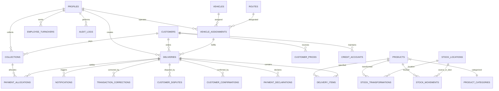

# TOKA GDMS — Database Schema & Data Integrity Specification (Confirmed Rules)

## 1. Relational Integrity & Schema Guarantees

GDMS enforces strict data integrity:
1. **Zero Hard Deletions**: Deletion of submitted deliveries, items, payment declarations, collections, stock movements, and audit records is blocked by PostgreSQL triggers.
2. **Restrictive Cascading (`ON DELETE RESTRICT`)**: Master records (customers, products, vehicles, routes) can never be deleted if historical transaction records reference them. Deactivation sets `is_active = false`.
3. **Traceable Sheet Transformations**: The split of 1 full sheet into 2 half sheets is explicitly recorded in `stock_transformations`.
4. **Append-Only Corrections**: Historical adjustments preserve original records and write linked entries to `transaction_corrections`.
5. **Realistic Immutability Boundaries**: Protection is enforced at the application role level via Row-Level Security, restricted database functions (`SECURITY DEFINER`), and strict trigger locks.

---

## 2. Complete Entity-Relationship Model (ERD)



---

## 3. PostgreSQL DDL Specification

```sql
-- Enable necessary extensions
CREATE EXTENSION IF NOT EXISTS "uuid-ossp";
CREATE EXTENSION IF NOT EXISTS "pgcrypto";

-- ============================================================================
-- 1. ENUMS & CORE VALUE TYPES
-- ============================================================================

CREATE TYPE user_role_enum AS ENUM (
    'owner',
    'manager',
    'salesperson',
    'driver',
    'cash_collector',
    'accountant'
);

-- Confirmed sales units: Full Sheet (default), Half Sheet (by customer order), Piece (pre-cut item)
CREATE TYPE selling_unit_enum AS ENUM (
    'FULL_SHEET',
    'HALF_SHEET',
    'PIECE'
);

CREATE TYPE operational_status_enum AS ENUM (
    'draft',
    'submitted',
    'dispatched',
    'delivered',
    'cancelled',
    'correction_pending'
);

CREATE TYPE payment_status_enum AS ENUM (
    'unpaid',
    'partially_paid',
    'fully_paid',
    'credit'
);

CREATE TYPE reconciliation_status_enum AS ENUM (
    'pending_reconciliation',
    'partially_reconciled',
    'reconciled',
    'discrepancy_flagged'
);

CREATE TYPE customer_confirmation_enum AS ENUM (
    'pending',
    'confirmed',
    'disputed',
    'no_response'
);

CREATE TYPE payment_channel_enum AS ENUM (
    'cash',
    'mpesa_company_till',
    'mpesa_employee_phone',
    'bank_transfer',
    'credit'
);

CREATE TYPE approval_status_enum AS ENUM ('pending', 'approved', 'rejected');

CREATE TYPE stock_location_type_enum AS ENUM ('warehouse', 'truck', 'transit');

CREATE TYPE movement_type_enum AS ENUM (
    'stock_receipt',
    'dispatch_to_truck',
    'delivery_to_customer',
    'return_from_truck',
    'broken_or_damaged',
    'split_full_to_half',
    'authorized_adjustment'
);

CREATE TYPE dispute_category_enum AS ENUM (
    'wrong_items_or_quantities',
    'incorrect_price',
    'wrong_payment_declared',
    'delivery_never_received',
    'damaged_glass_uncredited',
    'other'
);

CREATE TYPE inbound_sms_status_enum AS ENUM (
    'received',
    'processed',
    'ambiguous',
    'invalid_reference',
    'unmatched',
    'failed'
);

-- ============================================================================
-- 2. PROFILES & USER ROLES
-- ============================================================================

CREATE TABLE profiles (
    id UUID PRIMARY KEY REFERENCES auth.users(id) ON DELETE RESTRICT,
    full_name TEXT NOT NULL CHECK (length(trim(full_name)) > 0),
    phone_number TEXT NOT NULL UNIQUE CHECK (phone_number ~ '^\+[1-9]\d{7,14}$'),
    role user_role_enum NOT NULL DEFAULT 'salesperson',
    is_active BOOLEAN NOT NULL DEFAULT true,
    created_at TIMESTAMPTZ NOT NULL DEFAULT timezone('utc', now()),
    updated_at TIMESTAMPTZ NOT NULL DEFAULT timezone('utc', now())
);
CREATE INDEX idx_profiles_role ON profiles(role);
CREATE INDEX idx_profiles_active ON profiles(is_active);

-- ============================================================================
-- 3. CUSTOMERS & CREDIT ACCOUNTS
-- ============================================================================

CREATE TABLE customers (
    id UUID PRIMARY KEY DEFAULT gen_random_uuid(),
    account_number TEXT NOT NULL UNIQUE CHECK (length(trim(account_number)) > 0),
    name TEXT NOT NULL CHECK (length(trim(name)) > 0),
    primary_phone TEXT NOT NULL CHECK (primary_phone ~ '^\+[1-9]\d{7,14}$'),
    alt_phone TEXT CHECK (alt_phone IS NULL OR alt_phone ~ '^\+[1-9]\d{7,14}$'),
    delivery_area TEXT NOT NULL,
    default_gps_lat NUMERIC(10, 7) CHECK (default_gps_lat BETWEEN -90 AND 90),
    default_gps_lng NUMERIC(10, 7) CHECK (default_gps_lng BETWEEN -180 AND 180),
    is_credit_eligible BOOLEAN NOT NULL DEFAULT false,
    credit_limit NUMERIC(14, 2) NOT NULL DEFAULT 0.00 CHECK (credit_limit >= 0.00),
    is_active BOOLEAN NOT NULL DEFAULT true,
    created_by UUID NOT NULL REFERENCES profiles(id) ON DELETE RESTRICT,
    created_at TIMESTAMPTZ NOT NULL DEFAULT timezone('utc', now()),
    updated_at TIMESTAMPTZ NOT NULL DEFAULT timezone('utc', now())
);
CREATE INDEX idx_customers_phone ON customers(primary_phone);
CREATE INDEX idx_customers_account ON customers(account_number);

CREATE TABLE customer_contacts (
    id UUID PRIMARY KEY DEFAULT gen_random_uuid(),
    customer_id UUID NOT NULL REFERENCES customers(id) ON DELETE RESTRICT,
    contact_name TEXT NOT NULL,
    phone_number TEXT NOT NULL CHECK (phone_number ~ '^\+[1-9]\d{7,14}$'),
    role_description TEXT,
    is_primary BOOLEAN NOT NULL DEFAULT false,
    created_at TIMESTAMPTZ NOT NULL DEFAULT timezone('utc', now())
);
CREATE INDEX idx_customer_contacts_cust ON customer_contacts(customer_id);

CREATE TABLE credit_accounts (
    customer_id UUID PRIMARY KEY REFERENCES customers(id) ON DELETE RESTRICT,
    current_balance NUMERIC(14, 2) NOT NULL DEFAULT 0.00,
    total_credit_extended NUMERIC(14, 2) NOT NULL DEFAULT 0.00 CHECK (total_credit_extended >= 0.00),
    total_credit_repaid NUMERIC(14, 2) NOT NULL DEFAULT 0.00 CHECK (total_credit_repaid >= 0.00),
    last_payment_date TIMESTAMPTZ,
    updated_at TIMESTAMPTZ NOT NULL DEFAULT timezone('utc', now())
);

-- ============================================================================
-- 4. PRODUCTS, CATEGORIES & PRICING
-- ============================================================================

CREATE TABLE product_categories (
    id UUID PRIMARY KEY DEFAULT gen_random_uuid(),
    name TEXT NOT NULL UNIQUE CHECK (length(trim(name)) > 0),
    description TEXT,
    created_at TIMESTAMPTZ NOT NULL DEFAULT timezone('utc', now())
);

CREATE TABLE products (
    id UUID PRIMARY KEY DEFAULT gen_random_uuid(),
    category_id UUID NOT NULL REFERENCES product_categories(id) ON DELETE RESTRICT,
    sku TEXT NOT NULL UNIQUE CHECK (length(trim(sku)) > 0),
    name TEXT NOT NULL CHECK (length(trim(name)) > 0), -- e.g. '5mm Clear Sheet Glass (2440x1830)'
    thickness_mm NUMERIC(5, 2) NOT NULL CHECK (thickness_mm > 0),
    color TEXT NOT NULL, -- e.g. 'Clear', 'Bronze', 'Dark Grey', 'Silver Mirror'
    standard_dimension_label TEXT NOT NULL, -- e.g. '2440mm x 1830mm'
    standard_full_sheet_price NUMERIC(14, 2) NOT NULL CHECK (standard_full_sheet_price >= 0.00),
    standard_half_sheet_price NUMERIC(14, 2) NOT NULL CHECK (standard_half_sheet_price >= 0.00),
    standard_piece_price NUMERIC(14, 2) CHECK (standard_piece_price IS NULL OR standard_piece_price >= 0.00),
    is_active BOOLEAN NOT NULL DEFAULT true,
    created_at TIMESTAMPTZ NOT NULL DEFAULT timezone('utc', now()),
    updated_at TIMESTAMPTZ NOT NULL DEFAULT timezone('utc', now())
);
CREATE INDEX idx_products_sku ON products(sku);

CREATE TABLE customer_prices (
    id UUID PRIMARY KEY DEFAULT gen_random_uuid(),
    customer_id UUID NOT NULL REFERENCES customers(id) ON DELETE RESTRICT,
    product_id UUID NOT NULL REFERENCES products(id) ON DELETE RESTRICT,
    selling_unit selling_unit_enum NOT NULL,
    authorized_price NUMERIC(14, 2) NOT NULL CHECK (authorized_price >= 0.00),
    authorized_by UUID NOT NULL REFERENCES profiles(id) ON DELETE RESTRICT,
    valid_from TIMESTAMPTZ NOT NULL DEFAULT timezone('utc', now()),
    valid_to TIMESTAMPTZ,
    created_at TIMESTAMPTZ NOT NULL DEFAULT timezone('utc', now()),
    UNIQUE(customer_id, product_id, selling_unit)
);
CREATE INDEX idx_customer_prices_lookup ON customer_prices(customer_id, product_id, selling_unit);

CREATE TABLE price_approval_requests (
    id UUID PRIMARY KEY DEFAULT gen_random_uuid(),
    delivery_reference TEXT NOT NULL,
    product_id UUID NOT NULL REFERENCES products(id) ON DELETE RESTRICT,
    selling_unit selling_unit_enum NOT NULL,
    requested_by UUID NOT NULL REFERENCES profiles(id) ON DELETE RESTRICT,
    official_price NUMERIC(14, 2) NOT NULL CHECK (official_price >= 0.00),
    requested_price NUMERIC(14, 2) NOT NULL CHECK (requested_price >= 0.00),
    reason TEXT NOT NULL CHECK (length(trim(reason)) > 0),
    status approval_status_enum NOT NULL DEFAULT 'pending',
    reviewed_by UUID REFERENCES profiles(id) ON DELETE RESTRICT,
    reviewed_at TIMESTAMPTZ,
    rejection_reason TEXT,
    created_at TIMESTAMPTZ NOT NULL DEFAULT timezone('utc', now()),
    CONSTRAINT chk_different_reviewer CHECK (requested_by != reviewed_by),
    CONSTRAINT chk_price_discount CHECK (requested_price < official_price)
);
CREATE INDEX idx_price_approvals_status ON price_approval_requests(status);

-- ============================================================================
-- 5. FLEET & ROUTE ASSIGNMENTS
-- ============================================================================

CREATE TABLE vehicles (
    id UUID PRIMARY KEY DEFAULT gen_random_uuid(),
    registration_plate TEXT NOT NULL UNIQUE CHECK (length(trim(registration_plate)) > 0),
    make_model TEXT NOT NULL,
    tonnage_capacity NUMERIC(6, 2) NOT NULL CHECK (tonnage_capacity > 0),
    status TEXT NOT NULL DEFAULT 'active' CHECK (status IN ('active', 'maintenance', 'grounded')),
    external_tracker_id TEXT,
    is_active BOOLEAN NOT NULL DEFAULT true,
    created_at TIMESTAMPTZ NOT NULL DEFAULT timezone('utc', now())
);

CREATE TABLE routes (
    id UUID PRIMARY KEY DEFAULT gen_random_uuid(),
    code TEXT NOT NULL UNIQUE CHECK (length(trim(code)) > 0),
    name TEXT NOT NULL CHECK (length(trim(name)) > 0),
    description TEXT,
    is_active BOOLEAN NOT NULL DEFAULT true,
    created_at TIMESTAMPTZ NOT NULL DEFAULT timezone('utc', now())
);

CREATE TABLE vehicle_assignments (
    id UUID PRIMARY KEY DEFAULT gen_random_uuid(),
    vehicle_id UUID NOT NULL REFERENCES vehicles(id) ON DELETE RESTRICT,
    route_id UUID NOT NULL REFERENCES routes(id) ON DELETE RESTRICT,
    driver_id UUID NOT NULL REFERENCES profiles(id) ON DELETE RESTRICT,
    salesperson_id UUID NOT NULL REFERENCES profiles(id) ON DELETE RESTRICT,
    shift_date DATE NOT NULL DEFAULT CURRENT_DATE,
    started_at TIMESTAMPTZ NOT NULL DEFAULT timezone('utc', now()),
    ended_at TIMESTAMPTZ,
    is_active BOOLEAN NOT NULL DEFAULT true,
    created_at TIMESTAMPTZ NOT NULL DEFAULT timezone('utc', now()),
    CONSTRAINT chk_shift_times CHECK (ended_at IS NULL OR ended_at >= started_at)
);
CREATE INDEX idx_assignments_active ON vehicle_assignments(is_active) WHERE is_active = true;

-- ============================================================================
-- 6. DELIVERIES & LINE ITEMS
-- ============================================================================

CREATE TABLE deliveries (
    id UUID PRIMARY KEY DEFAULT gen_random_uuid(),
    delivery_reference TEXT NOT NULL UNIQUE CHECK (length(trim(delivery_reference)) > 0),
    client_tx_id UUID NOT NULL UNIQUE,
    customer_id UUID NOT NULL REFERENCES customers(id) ON DELETE RESTRICT,
    created_by UUID NOT NULL REFERENCES profiles(id) ON DELETE RESTRICT,
    vehicle_assignment_id UUID NOT NULL REFERENCES vehicle_assignments(id) ON DELETE RESTRICT,
    
    operational_status operational_status_enum NOT NULL DEFAULT 'draft',
    payment_status payment_status_enum NOT NULL DEFAULT 'unpaid',
    reconciliation_status reconciliation_status_enum NOT NULL DEFAULT 'pending_reconciliation',
    customer_confirmation_status customer_confirmation_enum NOT NULL DEFAULT 'pending',

    subtotal_amount NUMERIC(14, 2) NOT NULL DEFAULT 0.00 CHECK (subtotal_amount >= 0.00),
    discount_amount NUMERIC(14, 2) NOT NULL DEFAULT 0.00 CHECK (discount_amount >= 0.00),
    total_amount NUMERIC(14, 2) NOT NULL DEFAULT 0.00 CHECK (total_amount >= 0.00),
    total_declared_paid NUMERIC(14, 2) NOT NULL DEFAULT 0.00 CHECK (total_declared_paid >= 0.00),
    outstanding_balance NUMERIC(14, 2) NOT NULL DEFAULT 0.00 CHECK (outstanding_balance >= 0.00),

    delivery_lat NUMERIC(10, 7) CHECK (delivery_lat IS NULL OR delivery_lat BETWEEN -90 AND 90),
    delivery_lng NUMERIC(10, 7) CHECK (delivery_lng IS NULL OR delivery_lng BETWEEN -180 AND 180),
    gps_accuracy_m NUMERIC(6, 2) CHECK (gps_accuracy_m IS NULL OR gps_accuracy_m >= 0),
    device_captured_at TIMESTAMPTZ,
    submitted_at TIMESTAMPTZ,
    synced_at TIMESTAMPTZ NOT NULL DEFAULT timezone('utc', now()),
    is_offline_submission BOOLEAN NOT NULL DEFAULT false,
    
    notes TEXT,
    created_at TIMESTAMPTZ NOT NULL DEFAULT timezone('utc', now()),
    updated_at TIMESTAMPTZ NOT NULL DEFAULT timezone('utc', now()),
    
    CONSTRAINT chk_delivery_totals CHECK (total_amount = subtotal_amount - discount_amount)
);
CREATE INDEX idx_deliveries_ref ON deliveries(delivery_reference);
CREATE INDEX idx_deliveries_customer ON deliveries(customer_id);
CREATE INDEX idx_deliveries_submitted ON deliveries(submitted_at DESC);

CREATE TABLE delivery_items (
    id UUID PRIMARY KEY DEFAULT gen_random_uuid(),
    delivery_id UUID NOT NULL REFERENCES deliveries(id) ON DELETE RESTRICT,
    product_id UUID NOT NULL REFERENCES products(id) ON DELETE RESTRICT,
    selling_unit selling_unit_enum NOT NULL,

    -- Confirmed Sales Model: Full Sheet, Half Sheet, or Piece
    quantity INT NOT NULL CHECK (quantity > 0),
    full_sheet_equivalent NUMERIC(10, 2) NOT NULL CHECK (full_sheet_equivalent >= 0.00),

    official_unit_price NUMERIC(14, 2) NOT NULL CHECK (official_unit_price >= 0.00),
    applied_unit_price NUMERIC(14, 2) NOT NULL CHECK (applied_unit_price >= 0.00),
    is_special_price BOOLEAN NOT NULL DEFAULT false,
    price_approval_id UUID REFERENCES price_approval_requests(id) ON DELETE RESTRICT,
    line_total NUMERIC(14, 2) NOT NULL CHECK (line_total >= 0.00),
    
    created_at TIMESTAMPTZ NOT NULL DEFAULT timezone('utc', now()),

    -- Validate FSE math per selling unit
    CONSTRAINT chk_item_fse CHECK (
        (selling_unit = 'FULL_SHEET' AND full_sheet_equivalent = quantity * 1.0) OR
        (selling_unit = 'HALF_SHEET' AND full_sheet_equivalent = quantity * 0.5) OR
        (selling_unit = 'PIECE' AND full_sheet_equivalent = 0.0)
    )
);
CREATE INDEX idx_delivery_items_delivery ON delivery_items(delivery_id);

-- ============================================================================
-- 7. PAYMENT DECLARATIONS, COLLECTIONS & ALLOCATIONS
-- ============================================================================

CREATE TABLE payment_declarations (
    id UUID PRIMARY KEY DEFAULT gen_random_uuid(),
    delivery_id UUID NOT NULL REFERENCES deliveries(id) ON DELETE RESTRICT,
    channel payment_channel_enum NOT NULL,
    declared_amount NUMERIC(14, 2) NOT NULL CHECK (declared_amount > 0.00),
    declared_by UUID NOT NULL REFERENCES profiles(id) ON DELETE RESTRICT,
    external_ref TEXT,
    notes TEXT,
    created_at TIMESTAMPTZ NOT NULL DEFAULT timezone('utc', now())
);
CREATE INDEX idx_payments_delivery ON payment_declarations(delivery_id);

CREATE TABLE collections (
    id UUID PRIMARY KEY DEFAULT gen_random_uuid(),
    collection_reference TEXT NOT NULL UNIQUE CHECK (length(trim(collection_reference)) > 0),
    customer_id UUID NOT NULL REFERENCES customers(id) ON DELETE RESTRICT,
    collected_by UUID NOT NULL REFERENCES profiles(id) ON DELETE RESTRICT,
    channel payment_channel_enum NOT NULL,
    total_amount NUMERIC(14, 2) NOT NULL CHECK (total_amount > 0.00),
    allocated_amount NUMERIC(14, 2) NOT NULL DEFAULT 0.00 CHECK (allocated_amount >= 0.00),
    unallocated_amount NUMERIC(14, 2) NOT NULL DEFAULT 0.00 CHECK (unallocated_amount >= 0.00),
    external_ref TEXT,
    notes TEXT,
    collection_date TIMESTAMPTZ NOT NULL DEFAULT timezone('utc', now()),
    is_fully_allocated BOOLEAN NOT NULL DEFAULT false,
    reconciled_by UUID REFERENCES profiles(id) ON DELETE RESTRICT,
    reconciled_at TIMESTAMPTZ,
    created_at TIMESTAMPTZ NOT NULL DEFAULT timezone('utc', now()),
    CONSTRAINT chk_collection_amounts CHECK (total_amount = allocated_amount + unallocated_amount)
);
CREATE INDEX idx_collections_cust ON collections(customer_id);

CREATE TABLE payment_allocations (
    id UUID PRIMARY KEY DEFAULT gen_random_uuid(),
    collection_id UUID NOT NULL REFERENCES collections(id) ON DELETE RESTRICT,
    delivery_id UUID NOT NULL REFERENCES deliveries(id) ON DELETE RESTRICT,
    allocated_amount NUMERIC(14, 2) NOT NULL CHECK (allocated_amount > 0.00),
    allocated_by UUID NOT NULL REFERENCES profiles(id) ON DELETE RESTRICT,
    created_at TIMESTAMPTZ NOT NULL DEFAULT timezone('utc', now())
);
CREATE INDEX idx_allocations_delivery ON payment_allocations(delivery_id);
CREATE INDEX idx_allocations_collection ON payment_allocations(collection_id);

CREATE TABLE payment_reversals (
    id UUID PRIMARY KEY DEFAULT gen_random_uuid(),
    original_collection_id UUID REFERENCES collections(id) ON DELETE RESTRICT,
    original_payment_declaration_id UUID REFERENCES payment_declarations(id) ON DELETE RESTRICT,
    amount NUMERIC(14, 2) NOT NULL CHECK (amount > 0.00),
    reason TEXT NOT NULL CHECK (length(trim(reason)) > 0),
    requested_by UUID NOT NULL REFERENCES profiles(id) ON DELETE RESTRICT,
    approved_by UUID NOT NULL REFERENCES profiles(id) ON DELETE RESTRICT,
    created_at TIMESTAMPTZ NOT NULL DEFAULT timezone('utc', now()),
    CONSTRAINT chk_reversal_target CHECK (
        (original_collection_id IS NOT NULL AND original_payment_declaration_id IS NULL) OR
        (original_collection_id IS NULL AND original_payment_declaration_id IS NOT NULL)
    ),
    CONSTRAINT chk_different_reversal_approver CHECK (requested_by != approved_by)
);

CREATE TABLE employee_turnovers (
    id UUID PRIMARY KEY DEFAULT gen_random_uuid(),
    employee_id UUID NOT NULL REFERENCES profiles(id) ON DELETE RESTRICT,
    shift_date DATE NOT NULL DEFAULT CURRENT_DATE,
    cash_declared NUMERIC(14, 2) NOT NULL DEFAULT 0.00 CHECK (cash_declared >= 0.00),
    personal_mpesa_declared NUMERIC(14, 2) NOT NULL DEFAULT 0.00 CHECK (personal_mpesa_declared >= 0.00),
    cash_remitted NUMERIC(14, 2) NOT NULL DEFAULT 0.00 CHECK (cash_remitted >= 0.00),
    mpesa_forwarded NUMERIC(14, 2) NOT NULL DEFAULT 0.00 CHECK (mpesa_forwarded >= 0.00),
    variance NUMERIC(14, 2) NOT NULL DEFAULT 0.00,
    settled_with_cashier_id UUID REFERENCES profiles(id) ON DELETE RESTRICT,
    settled_at TIMESTAMPTZ,
    notes TEXT,
    created_at TIMESTAMPTZ NOT NULL DEFAULT timezone('utc', now())
);

-- ============================================================================
-- 8. CUSTOMER NOTIFICATIONS, INBOUND SMS & DISPUTES
-- ============================================================================

CREATE TABLE inbound_sms_messages (
    id UUID PRIMARY KEY DEFAULT gen_random_uuid(),
    provider_message_id TEXT NOT NULL UNIQUE,
    sender_phone TEXT NOT NULL CHECK (sender_phone ~ '^\+[1-9]\d{7,14}$'),
    raw_message_text TEXT NOT NULL,
    matched_delivery_id UUID REFERENCES deliveries(id) ON DELETE RESTRICT,
    processing_status inbound_sms_status_enum NOT NULL DEFAULT 'received',
    failure_reason TEXT,
    received_at TIMESTAMPTZ NOT NULL DEFAULT timezone('utc', now()),
    processed_at TIMESTAMPTZ
);
CREATE INDEX idx_inbound_sms_sender ON inbound_sms_messages(sender_phone, received_at DESC);

CREATE TABLE customer_confirmations (
    id UUID PRIMARY KEY DEFAULT gen_random_uuid(),
    delivery_id UUID NOT NULL UNIQUE REFERENCES deliveries(id) ON DELETE RESTRICT,
    inbound_sms_id UUID NOT NULL REFERENCES inbound_sms_messages(id) ON DELETE RESTRICT,
    reply_channel TEXT NOT NULL DEFAULT 'SMS',
    response_code TEXT NOT NULL CHECK (response_code IN ('1', '2')),
    sender_phone TEXT NOT NULL,
    received_at TIMESTAMPTZ NOT NULL DEFAULT timezone('utc', now())
);

CREATE TABLE customer_disputes (
    id UUID PRIMARY KEY DEFAULT gen_random_uuid(),
    delivery_id UUID NOT NULL REFERENCES deliveries(id) ON DELETE RESTRICT,
    customer_id UUID NOT NULL REFERENCES customers(id) ON DELETE RESTRICT,
    inbound_sms_id UUID REFERENCES inbound_sms_messages(id) ON DELETE RESTRICT,
    dispute_category dispute_category_enum,
    customer_notes TEXT,
    is_active BOOLEAN NOT NULL DEFAULT true,
    investigated_by UUID REFERENCES profiles(id) ON DELETE RESTRICT,
    resolution_notes TEXT,
    resolved_at TIMESTAMPTZ,
    created_at TIMESTAMPTZ NOT NULL DEFAULT timezone('utc', now())
);
CREATE INDEX idx_disputes_active ON customer_disputes(is_active) WHERE is_active = true;

CREATE TABLE notifications (
    id UUID PRIMARY KEY DEFAULT gen_random_uuid(),
    delivery_id UUID REFERENCES deliveries(id) ON DELETE RESTRICT,
    customer_phone TEXT NOT NULL CHECK (customer_phone ~ '^\+[1-9]\d{7,14}$'),
    channel TEXT NOT NULL DEFAULT 'SMS',
    payload TEXT NOT NULL,
    provider TEXT NOT NULL DEFAULT 'AFRICAS_TALKING',
    status TEXT NOT NULL DEFAULT 'queued' CHECK (status IN ('queued', 'sent', 'delivered', 'failed')),
    attempts INT NOT NULL DEFAULT 0,
    next_retry_at TIMESTAMPTZ,
    created_at TIMESTAMPTZ NOT NULL DEFAULT timezone('utc', now()),
    sent_at TIMESTAMPTZ
);

-- ============================================================================
-- 9. INVENTORY, SHEET TRANSFORMATIONS & STOCK MOVEMENTS
-- ============================================================================

CREATE TABLE stock_locations (
    id UUID PRIMARY KEY DEFAULT gen_random_uuid(),
    name TEXT NOT NULL UNIQUE CHECK (length(trim(name)) > 0),
    location_type stock_location_type_enum NOT NULL,
    vehicle_id UUID REFERENCES vehicles(id) ON DELETE RESTRICT,
    is_active BOOLEAN NOT NULL DEFAULT true,
    created_at TIMESTAMPTZ NOT NULL DEFAULT timezone('utc', now())
);

-- Explicit Transformation Record: 1 Full Sheet Consumed -> 2 Half Sheets Produced
CREATE TABLE stock_transformations (
    id UUID PRIMARY KEY DEFAULT gen_random_uuid(),
    product_id UUID NOT NULL REFERENCES products(id) ON DELETE RESTRICT,
    stock_location_id UUID NOT NULL REFERENCES stock_locations(id) ON DELETE RESTRICT,
    full_sheets_consumed INT NOT NULL CHECK (full_sheets_consumed > 0),
    half_sheets_produced INT NOT NULL CHECK (half_sheets_produced = full_sheets_consumed * 2),
    operator_id UUID NOT NULL REFERENCES profiles(id) ON DELETE RESTRICT,
    notes TEXT,
    created_at TIMESTAMPTZ NOT NULL DEFAULT timezone('utc', now())
);
CREATE INDEX idx_transformations_prod ON stock_transformations(product_id);
CREATE INDEX idx_transformations_loc ON stock_transformations(stock_location_id);

CREATE TABLE stock_movements (
    id UUID PRIMARY KEY DEFAULT gen_random_uuid(),
    product_id UUID NOT NULL REFERENCES products(id) ON DELETE RESTRICT,
    from_location_id UUID REFERENCES stock_locations(id) ON DELETE RESTRICT,
    to_location_id UUID REFERENCES stock_locations(id) ON DELETE RESTRICT,
    
    -- Track physical full and half sheets
    full_sheets_delta INT NOT NULL DEFAULT 0,
    half_sheets_delta INT NOT NULL DEFAULT 0,
    pieces_delta INT NOT NULL DEFAULT 0,
    fse_delta NUMERIC(10, 2) NOT NULL, -- full_sheets_delta + (half_sheets_delta * 0.5)
    
    movement_type movement_type_enum NOT NULL,
    responsible_employee_id UUID NOT NULL REFERENCES profiles(id) ON DELETE RESTRICT,
    authorized_by UUID REFERENCES profiles(id) ON DELETE RESTRICT,
    delivery_id UUID REFERENCES deliveries(id) ON DELETE RESTRICT,
    transformation_id UUID REFERENCES stock_transformations(id) ON DELETE RESTRICT,
    notes TEXT,
    created_at TIMESTAMPTZ NOT NULL DEFAULT timezone('utc', now()),
    
    CONSTRAINT chk_movement_endpoints CHECK (from_location_id IS NOT NULL OR to_location_id IS NOT NULL)
);
CREATE INDEX idx_stock_movements_prod ON stock_movements(product_id);
CREATE INDEX idx_stock_movements_type ON stock_movements(movement_type);

-- ============================================================================
-- 10. GPS TELEMETRY & AUDIT TRAILS
-- ============================================================================

CREATE TABLE location_samples (
    id UUID PRIMARY KEY DEFAULT gen_random_uuid(),
    employee_id UUID NOT NULL REFERENCES profiles(id) ON DELETE RESTRICT,
    vehicle_assignment_id UUID REFERENCES vehicle_assignments(id) ON DELETE RESTRICT,
    latitude NUMERIC(10, 7) NOT NULL CHECK (latitude BETWEEN -90 AND 90),
    longitude NUMERIC(10, 7) NOT NULL CHECK (longitude BETWEEN -180 AND 180),
    accuracy_m NUMERIC(6, 2) NOT NULL CHECK (accuracy_m >= 0),
    source TEXT NOT NULL DEFAULT 'phone_gps' CHECK (source IN ('phone_gps', 'vehicle_tracker')),
    captured_at TIMESTAMPTZ NOT NULL,
    synced_at TIMESTAMPTZ NOT NULL DEFAULT timezone('utc', now())
);
CREATE INDEX idx_location_samples_lookup ON location_samples(employee_id, captured_at DESC);

CREATE TABLE audit_logs (
    id UUID PRIMARY KEY DEFAULT gen_random_uuid(),
    actor_id UUID REFERENCES profiles(id) ON DELETE RESTRICT,
    action_type TEXT NOT NULL,
    entity_name TEXT NOT NULL,
    entity_id UUID NOT NULL,
    ip_address TEXT,
    user_agent TEXT,
    payload_before JSONB,
    payload_after JSONB,
    created_at TIMESTAMPTZ NOT NULL DEFAULT timezone('utc', now())
);
CREATE INDEX idx_audit_logs_entity ON audit_logs(entity_name, entity_id);

CREATE TABLE transaction_corrections (
    id UUID PRIMARY KEY DEFAULT gen_random_uuid(),
    delivery_id UUID NOT NULL REFERENCES deliveries(id) ON DELETE RESTRICT,
    field_changed TEXT NOT NULL,
    original_value TEXT NOT NULL,
    corrected_value TEXT NOT NULL,
    reason TEXT NOT NULL CHECK (length(trim(reason)) > 0),
    requested_by UUID NOT NULL REFERENCES profiles(id) ON DELETE RESTRICT,
    approved_by UUID NOT NULL REFERENCES profiles(id) ON DELETE RESTRICT,
    created_at TIMESTAMPTZ NOT NULL DEFAULT timezone('utc', now()),
    CONSTRAINT chk_diff_correction_approver CHECK (requested_by != approved_by)
);

-- ============================================================================
-- 11. IMMUTABILITY TRIGGER FUNCTIONS
-- ============================================================================

CREATE OR REPLACE FUNCTION prevent_immutable_delete()
RETURNS TRIGGER 
LANGUAGE plpgsql
SECURITY DEFINER
SET search_path = public, pg_temp
AS $$
BEGIN
    RAISE EXCEPTION 'Permanent Record Error: Deletion of records from table % is strictly prohibited.', TG_TABLE_NAME;
END;
$$;

CREATE TRIGGER trg_no_delete_deliveries
BEFORE DELETE ON deliveries
FOR EACH ROW EXECUTE FUNCTION prevent_immutable_delete();

CREATE TRIGGER trg_no_delete_delivery_items
BEFORE DELETE ON delivery_items
FOR EACH ROW EXECUTE FUNCTION prevent_immutable_delete();

CREATE TRIGGER trg_no_delete_payment_declarations
BEFORE DELETE ON payment_declarations
FOR EACH ROW EXECUTE FUNCTION prevent_immutable_delete();

CREATE TRIGGER trg_no_delete_collections
BEFORE DELETE ON collections
FOR EACH ROW EXECUTE FUNCTION prevent_immutable_delete();

CREATE TRIGGER trg_no_delete_allocations
BEFORE DELETE ON payment_allocations
FOR EACH ROW EXECUTE FUNCTION prevent_immutable_delete();

CREATE TRIGGER trg_no_delete_stock_movements
BEFORE DELETE ON stock_movements
FOR EACH ROW EXECUTE FUNCTION prevent_immutable_delete();

CREATE TRIGGER trg_no_delete_transformations
BEFORE DELETE ON stock_transformations
FOR EACH ROW EXECUTE FUNCTION prevent_immutable_delete();

CREATE TRIGGER trg_no_delete_audit_logs
BEFORE DELETE ON audit_logs
FOR EACH ROW EXECUTE FUNCTION prevent_immutable_delete();

CREATE TRIGGER trg_no_delete_confirmations
BEFORE DELETE ON customer_confirmations
FOR EACH ROW EXECUTE FUNCTION prevent_immutable_delete();

CREATE TRIGGER trg_no_delete_disputes
BEFORE DELETE ON customer_disputes
FOR EACH ROW EXECUTE FUNCTION prevent_immutable_delete();

CREATE TRIGGER trg_no_delete_corrections
BEFORE DELETE ON transaction_corrections
FOR EACH ROW EXECUTE FUNCTION prevent_immutable_delete();
```
