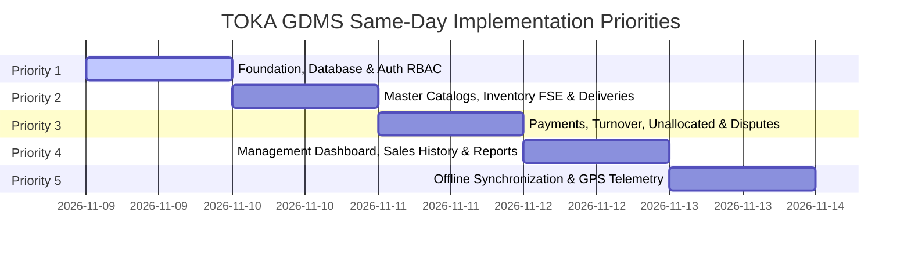

# TOKA GDMS — Phased Implementation Roadmap & Governance (Confirmed Rules)

## 1. Architectural Governance & Anti-Retrofit Principles

1. **No Big-Bang Releases**: Development progresses through sequential, strictly bounded priorities leading to an MVP today.
2. **Confirmed Glass Sales Model**: Full Sheets by default; Half Sheets only by customer order. Splitting 1 full sheet produces 2 half sheets (1 sold, 1 remains in physical stock). No arbitrary custom cutting or offcut scrap thresholds.
3. **Offline-First Foundations from Day 1**: Offline compatibility is **not** an afterthought. Data models, client UUID generation (`client_tx_id`), Decimal.js arithmetic, and IndexedDB outbox schemas are integrated into the core architecture from Phase 1.
4. **Unallocated Collections Isolation**: Unallocated customer payments remain visible as unapplied customer credit. They are never arbitrarily applied to invoices without explicit `payment_allocations`.
5. **Strict Definitions of Done (DoD)**: Progression requires 100% pass rates on automated unit/integration tests and functional verification.

---

## 2. Implementation Priority Sequence for Same-Day MVP

---

## 3. Detailed Scope & Testable Definitions of Done

### Priority 1: Foundation, Database & Auth/RBAC
- **Scope**:
  - Next.js 15+ App Router, TypeScript strict, Tailwind CSS v4, Lucide icons.
  - Supabase client integration (`@supabase/ssr`).
  - Auth sessions, profile management, and initial Owner bootstrap seed.
  - Full PostgreSQL DDL migrations (27 tables) with `ON DELETE RESTRICT` and immutability triggers.
  - Core Decimal.js arithmetic utilities and client UUID generators.
  - IndexedDB storage wrapper (`idb`) initialized with unified delivery schema.
- **DoD**:
  - Migrations apply successfully; all 6 roles resolve correctly via Supabase Auth and RLS.
  - Attempting to sign up with elevated privileges is rejected by RLS.

### Priority 2: Master Business Catalogs, Full/Half Sheet Inventory & Deliveries
- **Scope**:
  - CRUD interfaces for Customers, Customer Contacts, and Customer-Specific Pricing.
  - Glass Product Master with Full-Sheet, Half-Sheet, and Piece pricing; thickness and color specifications.
  - Vehicles, Routes, and Daily Vehicle-to-Staff Shift Assignments (`vehicle_assignments`).
  - Mobile delivery creation form supporting `FULL_SHEET`, `HALF_SHEET`, `PIECE`.
  - Half-sheet split transformation logic: 1 full sheet consumed $\rightarrow$ 2 half sheets produced (1 delivered, 1 in stock).
  - Atomic delivery submission RPC with `client_tx_id` idempotency.
- **DoD**:
  - Creating a half-sheet delivery correctly transforms 1 full sheet into 2 half sheets, updates stock FSE, and persists the delivery.
  - Hard deletion of submitted deliveries triggers an exception.

### Priority 3: Payments, Turnover Settlement, Collections & Accountability
- **Scope**:
  - Payment declaration interface (Cash, Till M-Pesa, Employee Personal M-Pesa, Credit).
  - Outstanding balance calculation and customer credit limit validation.
  - Daily shift employee liability turnover settlement with cashier.
  - Cash Collector module: logging collections, unallocated collection isolation, and explicit multi-invoice allocations.
  - Africa's Talking API integration for SMS receipts and inbound webhook correlation (YES/NO/dispute options 1–5).
- **DoD**:
  - Mixed-payment delivery splits cash, M-Pesa, and credit accurately.
  - Unallocated collection reduces customer balance without altering open invoice balances.
  - Customer replying 1 marks delivery confirmed; replying 2 flags active dispute and alerts Owner.

### Priority 4: Management Dashboard, Sales History & Operational Intelligence
- **Scope**:
  - Executive summary cards (sales, collections, outstanding credit, active disputes, FSE stock).
  - Filterable permanent sales history (by customer, date, vehicle, route, employee, status).
  - Dispute resolution center with investigation notes and compensating corrections.
  - Financial reconciliation interface for Accountant.
  - Audit log viewer.
- **DoD**:
  - Owner can inspect full transaction history without verbal explanations.
  - Historical corrections preserve original records and log linked adjustment entries.

### Priority 5: Offline Synchronization Engine & Field Resilience
- **Scope**:
  - IndexedDB outbox queue with status lifecycle (`pending`, `syncing`, `synced`, `failed`).
  - Network state listeners (`navigator.onLine`) and manual sync trigger.
  - Server-side idempotency verification (`client_tx_id` exact match vs payload conflict).
  - Stale price and stale credit limit handling upon sync.
  - Point-in-time GPS stamp on delivery submission and fleet freshness warnings.
- **DoD**:
  - Creating delivery in airplane mode saves safely to IndexedDB.
  - Reconnecting syncs outbox exactly once with zero duplicate records.
