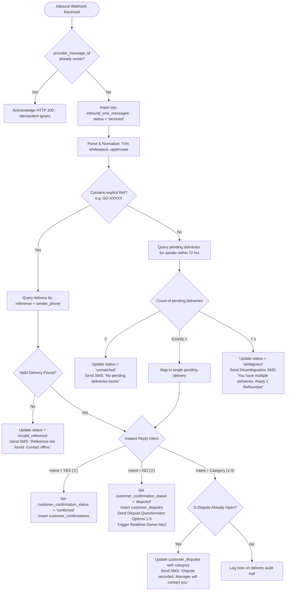

# GDMS — Notifications & Two-Way Customer Verification (Corrected & Aligned)

## 1. Role in Fraud Prevention & Operational Boundaries

Customer verification via SMS is an essential anti-fraud cross-check in GDMS. It closes the feedback loop directly with the glass purchaser without relying on the employee's verbal explanations or personal smartphone.

> [!IMPORTANT]
> **Legal & Technical Disclaimer**:
> An inbound SMS confirmation provides strong operational corroboration of goods received and cash handed over, but it does **not** constitute biometric proof of identity, a notarized digital signature, or a legally binding commercial contract under all circumstances. Customer confirmation is an operational integrity check and remains strictly separate from the Accountant's formal financial reconciliation.

---

## 2. Inbound SMS Persistent Event Model

Every webhook received from Africa's Talking (or any telecommunications provider) is immediately captured into the `inbound_sms_messages` table before any business logic executes:

```sql
-- Persistent Event Log for Inbound Telephony
CREATE TABLE inbound_sms_messages (
    id UUID PRIMARY KEY DEFAULT gen_random_uuid(),
    provider_message_id TEXT NOT NULL UNIQUE, -- Africa's Talking SMS id (idempotency)
    sender_phone TEXT NOT NULL,
    raw_message_text TEXT NOT NULL,
    matched_delivery_id UUID REFERENCES deliveries(id) ON DELETE RESTRICT,
    processing_status inbound_sms_status_enum NOT NULL DEFAULT 'received',
    failure_reason TEXT,
    received_at TIMESTAMPTZ NOT NULL DEFAULT timezone('utc', now()),
    processed_at TIMESTAMPTZ
);
```

### Inbound Status Lifecycle
- `received`: Payload safely stored in database; processing pending.
- `processed`: Successfully correlated with a delivery and updated confirmation/dispute state.
- `ambiguous`: Sender has multiple pending deliveries and replied without a specific delivery reference.
- `invalid_reference`: Message contained a reference code (e.g. `GD-99999`) that does not exist or belong to the sender.
- `unmatched`: Sender phone number has zero active deliveries in the system.
- `failed`: System or database error during webhook processing (eligible for retry).

---

## 3. Comprehensive Two-Way SMS State Machine



---

## 4. Specific Operational Edge Cases & Handling

### A. Multiple Pending Deliveries (The Disambiguation Engine)
- **Scenario**: Customer *Sunrise Hardware* receives two separate truck deliveries on the same morning (`GD-00125` at 9:00 AM, `GD-00126` at 11:30 AM). Customer texts back simply `"1"`.
- **Handling**:
  1. Webhook engine detects 2 pending deliveries for that phone number.
  2. The bare `"1"` is **not** guessed or arbitrarily assigned to the latest order.
  3. `inbound_sms_messages` is marked `processing_status = 'ambiguous'`.
  4. System dispatches automated SMS:
     ```text
     GLASS DISTRIBUTION NOTICE:
     You have 2 pending deliveries: GD-00125 and GD-00126.
     To confirm, please reply with the reference number:
     - Reply "1 GD-00125" for KES 20,000 delivery
     - Reply "1 GD-00126" for KES 15,000 delivery
     ```
  5. When customer replies `"1 GD-00125"`, the reference parser extracts `GD-00125` and executes confirmation.

### B. Explicit Delivery References
- The customer may reply in various formats: `"1 GD-00125"`, `"GD-00125 1"`, `"YES GD-00125"`, or `"GD-00125 YES"`.
- The parser applies regular expressions:
  - Reference pattern: `/(GD-\d{6}-\d{4}|GD-\d{4,6})/i`
  - Action code: `/^(1|2|YES|NO)\b/i` or `/\b(1|2|YES|NO)$/i`
- Successfully parsed commands execute the state transition immediately regardless of how many other deliveries are pending.

### C. Duplicate Inbound Webhooks
- Telecommunications providers frequently retry webhooks if latency exceeds 2,000ms.
- PostgreSQL enforces `UNIQUE (provider_message_id)`.
- If an incoming message ID already exists, the endpoint acknowledges HTTP 200 immediately without re-triggering confirmations or customer text replies.

### D. Delayed Inbound Replies (> 72 Hours)
- If a customer responds days later (e.g. 5 days after delivery), the reply is accepted and persisted in `customer_confirmations`, but flagged as `is_late_response = true`.
- If an accountant has already reconciled the invoice, the late response creates an audit notification rather than silently modifying closed financials.

### E. Inbound Messages After a Dispute Is Already Active
- If a delivery is already in `disputed` status and the customer sends subsequent texts (e.g., `"The driver only gave me 2 sheets, not 3"`):
  - The text is appended to `customer_disputes.customer_notes`.
  - A real-time notification pushes the update to the Owner/Manager dashboard under the active dispute case.
