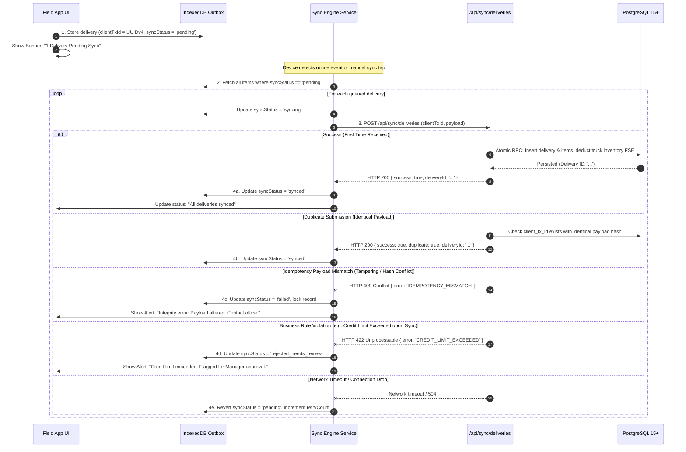

# TOKA GDMS — Offline-First Architecture & Synchronization Engine (Confirmed Rules)

## 1. Operational Necessity & Mobile Reality

Glass delivery routes routinely travel through rural areas, construction depots, and dead zones with intermittent mobile coverage. Drivers and salespeople cannot be blocked from recording deliveries, declaring cash/M-Pesa, or capturing GPS coordinates due to network loss.

### Honest Mobile Platform Assessment
- **Browser Background Sync Is NOT Guaranteed**: An ordinary browser PWA tab cannot guarantee background synchronization when the screen is locked or the browser is minimized.
- **Explicit Synchronization Model**: GDMS uses a reliable foreground sync engine that executes whenever the app is opened, active, or returns to network connectivity (`window.addEventListener('online')`), supplemented by a native Capacitor background worker where installed.
- **Strict Quarantine Rule**: A transaction that exists only in local IndexedDB is clearly badged as **"Pending Sync"**. It must **never** be presented on the management dashboard or in reports as server-synchronized until the server acknowledges receipt and persistence.

---

## 2. Unified Delivery & Outbox Data Model

The IndexedDB schema exactly mirrors the PostgreSQL relational schema and Next.js TypeScript definitions:

```typescript
// Confirmed Sales Units: Full Sheet by default, Half Sheet on customer order only
export type SellingUnit = 'FULL_SHEET' | 'HALF_SHEET';

export interface UnifiedDeliveryItem {
  id?: string;
  productId: string;
  sku: string;
  productName: string;
  sellingUnit: SellingUnit;
  quantity: number; // Positive integer
  fullSheetEquivalent: number; // 1.0 * quantity for FULL_SHEET, 0.5 * quantity for HALF_SHEET

  officialUnitPrice: number;
  appliedUnitPrice: number;
  isSpecialPrice: boolean;
  priceApprovalId?: string;
  lineTotal: number;
}

export interface PaymentDeclarationInput {
  channel: 'cash' | 'mpesa_company_till' | 'mpesa_employee_phone' | 'bank_transfer' | 'credit';
  declaredAmount: number;
  externalRef?: string;
  notes?: string;
}

export interface QueuedOfflineDelivery {
  clientTxId: string;             // Immutable UUIDv4 generated at form creation
  deliveryReference: string;      // Human-readable code: e.g. 'GD-202611-0012'
  customerId: string;
  customerAccountNumber: string;
  customerName: string;
  vehicleAssignmentId: string;
  
  items: UnifiedDeliveryItem[];
  payments: PaymentDeclarationInput[];

  subtotalAmount: number;
  discountAmount: number;
  totalAmount: number;
  totalDeclaredPaid: number;
  outstandingBalance: number;

  deliveryLat?: number;
  deliveryLng?: number;
  gpsAccuracyM?: number;
  deviceCapturedAt: string;
  isOfflineSubmission: boolean;

  syncStatus: 'pending' | 'syncing' | 'synced' | 'failed' | 'rejected_needs_review';
  retryCount: number;
  lastSyncAttempt?: string;
  syncErrorMessage?: string;
}
```

---

## 3. Idempotent Synchronization & Conflict Resolution Engine



---

## 4. Specific Stale Data Scenarios & Resolution Rules

### A. Offline Half-Sheet Order Execution
- If a field employee sells a half sheet offline, the local device checks cached truck inventory:
  - If a physical half sheet exists in truck stock, it is allocated.
  - If only full sheets exist in truck stock, the local state records a planned split transformation (1 full sheet consumed $\rightarrow$ 2 half sheets produced $\rightarrow$ 1 delivered + 1 remaining).
- Upon sync, the server executes the `stock_transformations` transaction atomically.

### B. Stale Cached Master Prices
- To protect customer goodwill and commercial honesty, the quoted offline price is respected if within standard salesperson tolerance ($\le 5\%$).
- If the discrepancy is large, the transaction is accepted but automatically flagged as `price_audit_flagged`, creating a review ticket for the Manager. Master catalog prices are **never** silently overwritten onto the delivery.

### C. Stale Customer Balances & Credit Limits
- Upon sync, the server recalculates $B_{\text{cust}} + B_{\text{inv}}$.
- If the new balance breaches the customer's authorized `credit_limit`, the delivery is accepted into `deliveries` but its operational status is flagged as `correction_pending` and an emergency credit review alert is dispatched to the Owner.

### D. Offline Special Price Approval Restrictions
- **Strict Invariant**: An employee **cannot** approve their own discount or grant offline credit waivers.
- If a delivery was recorded offline with a discounted price ($P_{\text{applied}} < P_{\text{official}}$), the transaction syncs with a linked `price_approval_requests` entry in `status = 'pending'`.
- The customer SMS confirmation is dispatched showing the applied price, but management is alerted that an unauthorized offline discount was submitted and requires formal sign-off.
